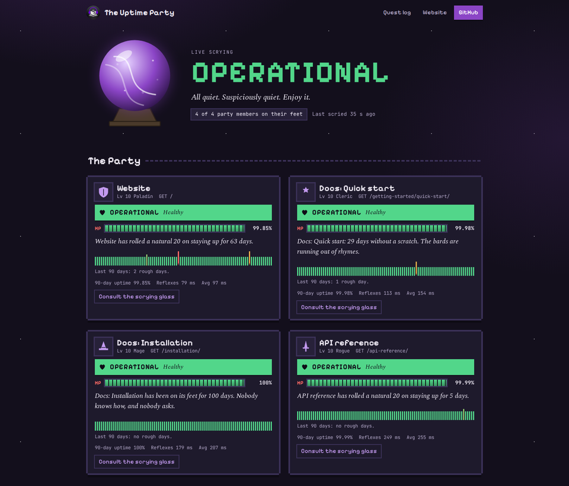
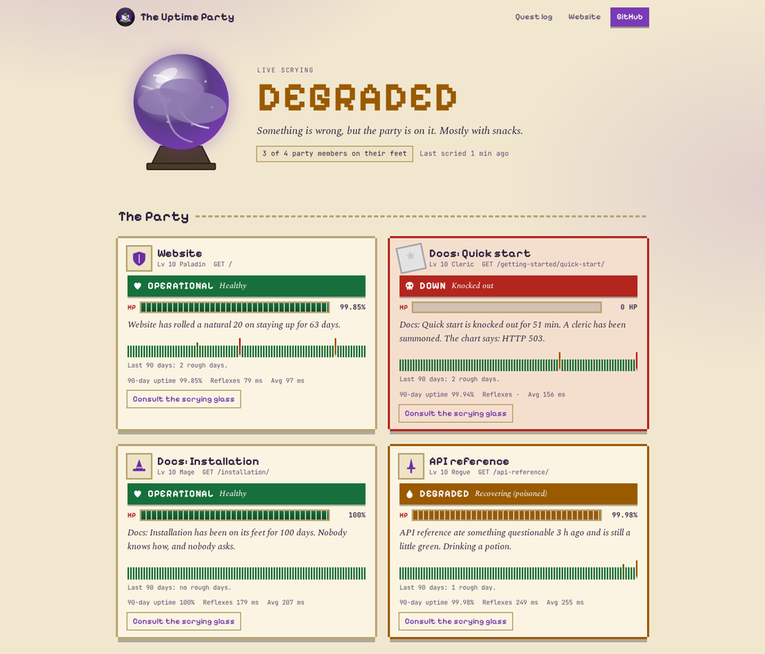

<p align="center">
  <picture>
    <source media="(prefers-color-scheme: dark)" srcset="docs/readme/abm-wordmark-dark.svg">
    <source media="(prefers-color-scheme: light)" srcset="docs/readme/abm-wordmark-light.svg">
    
  </picture>
</p>

<p align="center"><b>The status page for AudioBook Manager's website and docs.</b></p>

<p align="center">
  <a href="https://status.audiobookmanager.com"></a>
  
  <a href="LICENSE"></a>
</p>

<p align="center">
  <a href="https://github.com/sunbrolynk/ABM-Status/actions/workflows/checks.yml"></a>
</p>

<hr>

This is the uptime page for [AudioBook Manager](https://audiobookmanager.com), live at
[status.audiobookmanager.com](https://status.audiobookmanager.com). It runs on
[UptimeFlare](https://github.com/lyc8503/UptimeFlare) by lyc8503: a Cloudflare Worker checks
each target every minute and a Cloudflare Pages site shows the history.

## What the page looks like

<p align="center">
  
  
</p>

The page is an RPG party. Each monitor is a party member with a level, an HP bar for its 90-day
uptime, a status effect and a line of flavour text. The crystal ball at the top clears, clouds
over or goes dark with the overall state. Maintenance shows as the party taking a long rest, and
`/incidents` reads as a quest log. Every state carries its plain word (Operational, Degraded, Down
or Maintenance) as well as the colour and the joke, and the 90-day history can be read with the
keyboard.

A monitor is Degraded when it is up but recovered from an outage less than 24 hours ago. The
overall state is Degraded when any monitor is down or degraded, and Down only when every monitor
is down.

## What it watches

| Monitor | id | URL |
|---|---|---|
| Website | `site` | https://audiobookmanager.com/ |
| Docs: Quick start | `docs_quick_start` | https://audiobookmanager.com/getting-started/quick-start/ |
| Docs: Installation | `docs_installation` | https://audiobookmanager.com/installation/ |
| API reference | `api_reference` | https://audiobookmanager.com/api-reference/ |

ABM Radio (`radio.audiobookmanager.com`) is in `uptime.config.ts` but commented out, because the
name doesn't resolve yet. I'll switch it on when the station goes live.

## Adding or removing a monitor

Monitors live in the `monitors` list in `uptime.config.ts`. To add one, copy an entry and give
it a new `id`, a `name` and a `target` URL. To remove one, delete its entry. The `id` is what
keeps a monitor's history, so I never reuse an old one for a different URL. Edits go through a
PR into `dev` like any other change.

## Alerts

Downtime and recovery alerts go to a Discord channel through a webhook, after a monitor has been
down for 5 minutes. Changes in the error text while it's still down don't send another alert.
With no `DISCORD_WEBHOOK_URL` secret set, no alerts are sent.

## Secrets

| Secret | What it is |
|---|---|
| `CLOUDFLARE_API_TOKEN` | Cloudflare token with Workers, Pages and D1 edit rights |
| `CLOUDFLARE_ACCOUNT_ID` | Optional; looked up from the token when it's missing |
| `DISCORD_WEBHOOK_URL` | Discord webhook for alerts |

The webhook URL is inlined into the worker bundle at build time with `wrangler --define`, so it
never sits in the repo and never reaches the page.

## Deploying

`dev` is the work branch and changes land on it by PR. Merging the `dev` to `main` PR runs
`.github/workflows/deploy.yml`, which builds the worker and the page and applies them with
Terraform and wrangler.

On a first deploy, Cloudflare can take up to about 10 minutes to start a new cron trigger. Until
the worker's first run, the page says the monitor state isn't defined yet.

## Custom domain

`status.audiobookmanager.com` is a custom domain on the `uptimeflare-abm` Pages project. It's
set in the Cloudflare dashboard under Workers & Pages, then the project, then Custom domains.
The page is also at `uptimeflare-abm.pages.dev`.

## Cloudflare names

Every resource name here comes from one prefix, `uptimeflare-abm`, instead of upstream's fixed
`uptimeflare` names, so it can share a Cloudflare account with my other projects:

| Resource | Name |
|---|---|
| Worker | `uptimeflare-abm_worker` |
| D1 database | `uptimeflare-abm_d1` |
| Pages project | `uptimeflare-abm` |
| Old KV namespace the migration looks for | `uptimeflare-abm_kv` |

The prefix is `TF_VAR_UF_PREFIX` at the top of `deploy.yml`. These files carry the rename:

- `.github/workflows/deploy.yml`: the prefix, the Durable Object lookup, the Terraform imports
  and the Pages upload
- `deploy.tf`: the `UF_PREFIX` variable and the D1, Worker and Pages names
- `deploy/init_d1.py` and `deploy/migrate_kv.py`: the D1 and KV names
- `wrangler.toml`, `worker/wrangler.toml` and `entrypoint.sh`: the same names written out, for
  local builds and Docker

## Upstream updates

UptimeFlare's Upstream Sync workflow is disabled. It replaces everything except
`uptime.config.ts`, which would undo the rename and the repo checks, and the branch rules stop
it pushing to `main` anyway. I bring upstream changes in by hand: diff the new UptimeFlare
release against this repo on a branch off `dev`, take the changes, re-apply the rename to the
files above, and open a PR into `dev`.

## Working on it

```sh
bash scripts/install-hooks.sh
```

That installs the commit and push checks: gitleaks, a public-repo check for home-network
details, and a changelog check.

The page itself is in `components/party/`, its styles are in `styles/party.css` and the jokes
are in `components/party/copy.ts`. The fonts come from `@fontsource` packages, so the page makes
no third-party requests. The `customFooter` option in `uptime.config.ts` is no longer used; the
footer is `components/party/Footer.tsx`.

## Support

If you find AudioBook Manager useful, you can support it here:

<p align="center">
  <a href="https://ko-fi.com/sunbrolynk">
    
  </a>
  <a href="https://buymeacoffee.com/sunbrolynk">
    
  </a>
</p>

## Credits and licence

Built on [UptimeFlare](https://github.com/lyc8503/UptimeFlare) by
[lyc8503](https://github.com/lyc8503), under the Apache License 2.0. My changes are under the
same licence; see [LICENSE](LICENSE) and [NOTICE](NOTICE).
